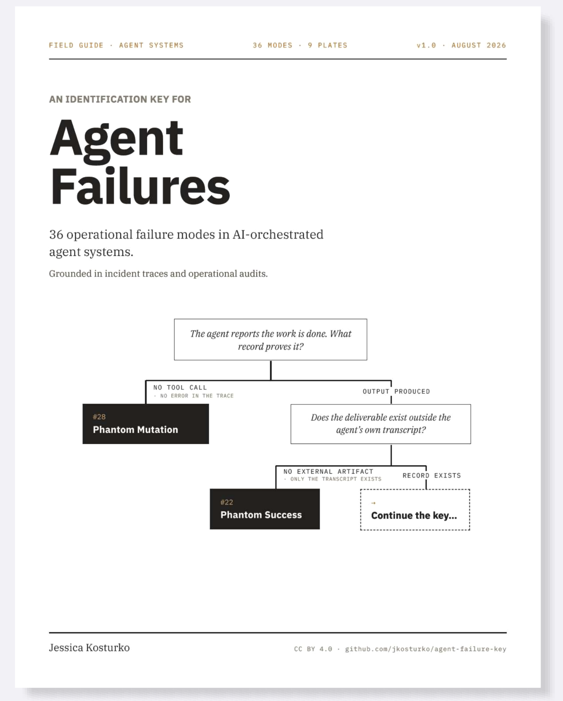

# Hi, I'm Jessica

I build AI agents, research how they fail, and publish it so the field can build agents that are safe to ship.

I led engineering at Google and the New York Times. Now I work on this full time: I run a fleet of AI agents every day, and the failures I publish come from that work.

## Focus areas

- how AI agents fail in production, and how to tell one failure from another
- checking that an agent did what was asked, not only that it reported success
- experiments on agents, such as fault injection with the prediction written down first
- solving the issue that we will soon expect humans to gate more systems than humans can meaningfully and reliably gate

## An Identification Key for Agent Failures

[**agent-failure-key**](https://github.com/jkosturko/agent-failure-key) is a playbook of differentiating failure modes so that systems can be built from the ground up with these failure modes in mind, and quick diagnostics when things go wrong.

It catalogs 36 failure modes in AI-orchestrated agent systems. Each one is grounded in logged incidents on an agent platform I designed and run in daily operation. Three of them:

- **Phantom Mutation.** The agent reports work it never did.
- **Probe Inflation.** The observer's probes inflate the health numbers.
- **Monitoring-Induced Rate Limit Amplification.** The watchdog causes the outage.

Free to use under CC BY 4.0, with a [PDF edition](https://intentgateway.ai/key).

  

## Intent Gateway

My company, [Intent Gateway](https://intentgateway.ai), makes a platform for building and running AI agents that measures whether each one did what was asked, and catches it when it didn't. The failure key came out of running it. The platform code is private.

## Open source

- [**agent-failure-key**](https://github.com/jkosturko/agent-failure-key): the identification key above.
- [**obsidian-live-git-diff**](https://github.com/jkosturko/obsidian-live-git-diff): a side-by-side rendered git diff for Obsidian. Review what your AI agent changed without losing your comments.
- [**sre-skills**](https://github.com/jkosturko/sre-skills): incident response, diagnosis and runbook skills for AI agents.

## Tech stack

**Agents and evaluation**

**Application**

## Get in touch

If you'd like to talk about agent failures, or you think I could help you or your organization make agents safe to ship, reach me on [LinkedIn](https://www.linkedin.com/in/jessicakosturko/).
